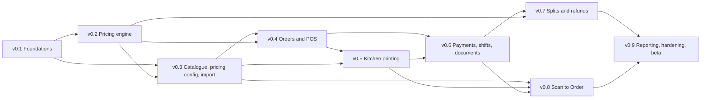

# Sail roadmap: v0.0 to v0.9

Status: draft for discussion, 29 Oct 2026.
Source of scope: `docs/sail-v0.9-scope.md` (referred to below as "the scope doc", with section numbers such as §4.8).
Architecture template: `docs/reference/launchpad-architecture.md`.

This roadmap splits the v0.9 scope into nine phases, ordered by dependency. Each phase says what it must achieve, what it includes and leaves out, what it depends on, how we know it is done, and what is most likely to go wrong. It is **not** an implementation plan. Each phase gets its own plan file before work on it starts (suggested path: `docs/plans/v0.N-<short-name>.md`), and that plan owns task breakdown, schema details, endpoint lists and test cases.

The scope doc stays the authority on *what* v0.9 contains. If this roadmap and the scope doc disagree, the scope doc wins and this file is corrected.

## 1. Sequencing principles

1. **Pricing first.** The pricing pipeline (§4.8) is the critical path and the top correctness risk. Totals, splits, refunds, receipts, invoices and reports all read its per-line adjustments, so it is built and proven as a pure function (v0.2) before anything that consumes it, and configured against the real catalogue (v0.3) before the POS uses it (v0.4).
2. **Infrastructure once, then reuse.** Launchpad's patterns (request and RLS pipeline, SSE over `pg_notify`, migrations, CI/deploy) and Sail's improvements to them (§10.1) are set up in v0.1. Later phases add principals, tables and streams to them; they do not invent new patterns.
3. **Real data early.** The CSV importer lands with the catalogue (v0.3), so every later phase is built and tested against the beta brands' real menus at real scale, not toy fixtures.
4. **Hardware risk before money flows.** Printing (v0.5) comes straight after orders can be fired, so the only hardware dependency is proven on site well before beta, and receipts can print as soon as payments exist.
5. **Self-contained and cuttable last.** Scan to Order (v0.8) is the first thing to cut if the schedule slips (§6), so it is scheduled after everything it depends on and nothing else depends on it.
6. **Every phase ends deployable.** Each phase ends with its work merged, migrated and deployed to staging, and to prod behind the normal approval, with its exit criteria demonstrated on staging. No phase leaves a half-built feature on `main` without a flag.

## 2. Phase overview

Sizes use the scope doc's scale (§6): S is a few days, M is one to two weeks, L is several weeks, for one full-stack developer. They are indicative and get firmed up in each phase plan.

| Phase | Name | Goal in one line | Size | Hard dependencies |
|-|-|-|-|-|
| v0.0 → v0.1 | Foundations | A deployed walking skeleton on Launchpad's patterns, with tenancy, staff, roles and audit | M | none |
| v0.1 → v0.2 | Pricing engine | The pricing pipeline as a pure, proven function in `shared` | L | v0.1 |
| v0.2 → v0.3 | Catalogue, pricing configuration and legacy import | Real menus, customers and pricing rules in the database, imported from CSV and editable in the back office | L | v0.1, v0.2 |
| v0.3 → v0.4 | Orders and the POS | Stations take, fire and edit orders of every type, with live server-authoritative pricing | L | v0.1–v0.3 |
| v0.4 → v0.5 | Kitchen printing | Fired items print reliably to network ESC/POS printers through a print relay | M | v0.3, v0.4 |
| v0.5 → v0.6 | Payments, shifts and tax documents | Orders are paid, receipted, invoiced and reconciled at shift close | M | v0.2, v0.4, v0.5 |
| v0.6 → v0.7 | Bill splitting and refunds | Checks split by item, seat or evenly; full and partial refunds with receipts and credit notes | M | v0.2, v0.6 |
| v0.7 → v0.8 | Scan to Order | Guests order to their table from their phones; staff accept, fire and charge at the POS | M | v0.3–v0.6 |
| v0.8 → v0.9 | Reporting, hardening and beta readiness | Operational reports, production hardening, and the two beta outlets live | M | all earlier phases |

**Critical path:** v0.1 → v0.2 → v0.3 → v0.4 → v0.6 → v0.7 → v0.9. Printing (v0.5) sits on it only because receipts in v0.6 print through the relay; the ESC/POS renderer and the relay itself have no dependency on orders and can be started early as a parallel track (section 5). Scan to Order (v0.8) is off the critical path by design.

## 3. Rules that apply to every phase

These are part of every phase's definition of done and are not repeated in each phase below.

- **Contract.** Every new or changed endpoint is defined with `@hono/zod-openapi`. The committed spec is updated and reviewed, and the web, guest and relay clients are regenerated from it. No client calls an endpoint that is missing from the spec (§10.2, condition 2).
- **Tenancy and RLS.** Every new table carries `merchant_id` (and `outlet_id` where relevant), has RLS policies, and is covered by RLS replay cases for every principal type that exists at that point. The RLS opt-out list stays at `/health` only unless a decision says otherwise.
- **Migrations.** Generated with `drizzle-kit generate`; hand-written SQL for RLS, grants, triggers, invariants and seeds. Forward-only, run on staging before prod, with drift checks either side (§10.2, condition 5).
- **Money.** Integer cents everywhere. Any new money-moving behaviour adds cases to the pricing reference set or property tests.
- **Mutations.** Client-generated UUIDs, an `Idempotency-Key` on every mutation, and an optimistic-concurrency version on anything two clients can edit (§7.1).
- **Audit.** Every new restricted or money-affecting action writes to the audit log, including the approver when a manager override was used.
- **Business logic on the server.** Clients only call the API. Pricing, allocation, tax, permissions, state transitions, stock and print routing never run only on a client (§7.1, rule 1).
- **No other POS by name.** Nothing in the repo (code, docs, seed data, fixtures, commit messages) names or quotes any other POS product. Migration features are described generically, for example "legacy POS importer".
- **Scope control.** Anything not in the scope doc needs a recorded decision before it is built. This applies with particular force to the pricing pipeline: anything outside §4.8 is out unless Phil decides otherwise.

---

## 4. Phases

### Phase 1: v0.0 → v0.1 — Foundations

**Goal.** A walking skeleton that is deployed to staging and prod, built on Launchpad's patterns with Sail's changes from §10.1, so that every later phase only adds features. It includes the organisation hierarchy, back-office login, staff, roles and the audit log, because every later phase needs them.

**In scope**
- Monorepo: pnpm workspaces and Turbo with packages `server`, `web` and `shared`. The `guest` and `relay` packages are created in the phases that need them.
- Server: Hono with `@hono/zod-openapi`, `AppError` error model, `/health`, and the committed OpenAPI spec with a CI check. Generated clients (`openapi-typescript` + `openapi-fetch`) behind Launchpad's `lib/api.ts` wrapper.
- Database access: postgres.js on the 6543 transaction pooler with `prepare: false`; a 5432 session connection from day one (for `LISTEN`, session-level advisory locks and migrations), with a test that rejects 6543 for `LISTEN`.
- Request pipeline: admission gate, one transaction per request, `rlsMiddleware` with `set_config('app.current_*')` and `SET LOCAL ROLE app_authenticated`, and the tested RLS opt-out list.
- Idempotency-Key middleware and storage, and the client-UUID convention.
- Live-update plumbing: the generic `pg_notify` → `LISTEN` → `streamSSE` fan-out, heartbeats, `resync` after a dropped `LISTEN` connection, and a `fetch`-streaming client helper with catch-up hooks. Proven with a test stream; real streams arrive in v0.4.
- Migrations discipline and the RLS replay harness in Docker Postgres.
- Environments and CI/CD: Supabase staging branch, staging Fly app, `sin` region; merge to `main` migrates and deploys staging; prod migrates and deploys only on manual approval or tag, then polls `/health`. Compiled JS (`node dist/index.js --role=X`), one image with `app` and `worker` roles, `min_machines_running = 2`, auto-stop off, concurrency type `connections`.
- Secrets per §10.1 that are needed now (database URLs including `LISTEN_DATABASE_URL`, Supabase, CORS, `STAGING_DATABASE_URL`).
- Observability baseline: structured logs, error tracking and an alert on 503s from the admission gate. The tooling choice is made in this phase (§10.1, "still unknown").
- Organisation model: merchants, `merchant_settings` (tax mode, cash-rounding increment, business-day cutoff), brands, outlets (hours, UEN, business-day cutoff), and station records (pairing comes in v0.4).
- Staff and access: the five fixed roles and the permission matrix, defined once in `shared`; staff records scoped to outlets and brands; back-office login with Supabase Auth (email).
- Audit log table and a single server-side writer.
- Back-office shell: the `(auth)` and `(backoffice)` route groups, navigation, and CRUD for outlets, brands and staff. Works on desktop and on iPad.

**Out of scope**
- Station pairing, PIN sessions and manager overrides (v0.4).
- Guest and relay principals (v0.8 and v0.5).
- Catalogue, pricing and orders (later phases).
- Passport SSO, unless Mission standardises on it for staff before this phase starts.

**Key deliverables**
- Running staging and prod environments with the deploy pipeline.
- Request, RLS, idempotency and SSE infrastructure with tests.
- Org, staff, role and audit tables with RLS replay cases.
- Back-office shell with org and staff management.
- A short `docs/` note on how to add a route, a table and a migration, so later phases follow one pattern.

**Dependencies.** None in code. Inputs needed at the start: Supabase and Fly accounts and plans, and the observability tooling decision. Also **request sample CSV exports from the legacy POS now**, because the v0.3 importer depends on them.

**Exit criteria / definition of done**
- A trivial change goes from PR to staging automatically, and to prod only after approval, with migrations applied on staging first and drift checks passing.
- The OpenAPI CI check fails on an unreviewed spec change.
- RLS replay tests show that two seeded merchants cannot see each other's rows, and that outlet scoping works for a staff member limited to one outlet.
- The test SSE stream reconnects and catches up after a rolling deploy, after the `LISTEN` connection is killed, and after an iPad Safari tab is backgrounded and restored.
- A back-office user can log in, create a brand and outlet, and add staff with a role and outlet scope; each action appears in the audit log.
- The 503 alert fires in a staging test that saturates the admission gate.

**Main risks**
| Risk | Mitigation |
|-|-|
| Over-building infrastructure before any feature exists | Scope is limited to what §10.1 lists; anything else waits for the phase that needs it. |
| Divergence from Launchpad patterns makes later help from Launchpad's engineer harder | Copy patterns first, then apply only the §10.1 changes; record any further deviation as a decision. |
| Unknown Supabase backup and point-in-time-recovery coverage | Confirm the plan's coverage in this phase; it is a hard requirement before prod holds real orders (v0.9). |
| Legacy CSV exports arrive late and block v0.3 | Request them at the start of this phase. |

---

### Phase 2: v0.1 → v0.2 — Pricing engine

**Goal.** The pricing pipeline from §4.8 exists as one pure function in `shared`, `price(order, rules, context) → adjustments`, and is proven correct against a hand-calculated reference set and property tests before anything depends on it.

**In scope**
- Zod schemas for pricing rules with the **fixed** field and condition set from §4.8: kind, calculation, fixed or open value, scope with exclusions, conditions (order types, channels, outlets and brands, minimum spend and its basis, customer groups, date range), cap, priority with rule-ID tiebreak, stacking, application (`auto`/`manual`), role and reason fields, GST flag and reporting class.
- Input types for an order (lines, modifiers, quantities, order type, channel, outlet, brand, customer groups, manually applied rules with entered values) and for the context (tax mode, evaluation time passed in explicitly).
- The seven pipeline steps: base prices with per-order-type prices; line-level discounts with exclusive/stackable; order-level discounts spread in proportion; fees with no compounding and fixed-per-unit support; GST per line, including GST-applicable fees, in both inclusive and exclusive tax modes; caps spread back across lines; largest-remainder rounding per rule.
- Output: adjustments with a rule snapshot, a total, and per-line amounts and GST, so every rule's lines add up to its total.
- Freeze support: given a set of frozen order-level and minimum-spend results, newly added lines are priced with line-level rules only. Payments that trigger the freeze arrive in v0.6, but the semantics are fixed here.
- Disabling rules from a manual rule, as needed by the service-charge waiver.
- A step-by-step **trace** output, which the back-office simulator displays in v0.3.
- Pure validation functions over a rule set and a catalogue snapshot: overlapping exclusive rules, products no fee covers, caps below the minimum.
- A shared **largest-remainder allocator** that splits an amount by shares deterministically. Splits and refunds in v0.7 build on it; a property test here proves that allocating every adjustment across N shares always sums back to the order.
- The seed configuration from §4.8 (service charge, BCRS container deposit, six manual presets) as typed fixtures. They become a database seed in v0.3.
- **Pricing reference set:** a readable fixture format for hand-calculated orders, and an initial set of at least 60 orders covering every rule type, condition, cap, stacking mode, per-order-type prices, BCRS, both tax modes and the freeze. The set grows to at least 150 by v0.9.
- Property-based tests (for example with fast-check) over random baskets and rule sets.
- A written semantics note for the pipeline in `docs/`, recording every interpretation decision made in this phase.

**Out of scope**
- Persisting rules, versioning and scheduled activation (v0.3).
- Any UI, including the simulator screen (v0.3).
- Cash rounding, which is a payment concern (v0.6).
- Split and refund functions beyond the allocator (v0.7).
- Every pricing feature listed as deferred in §5 (happy-hour conditions, buy-N-get-Y, compounding fees, promo codes, usage limits).

**Key deliverables**
- The `price` function, its schemas and its trace output in `shared`.
- The largest-remainder allocator.
- Seed rules as fixtures.
- Reference set (≥ 60 orders) and property tests running in CI.
- Pipeline semantics note.

**Dependencies.** v0.1: the `shared` package, Vitest and CI. Nothing else, so this phase can start while the tail of v0.1 (environments, back-office shell) is finished. Inputs needed: answers to scope-doc open question 1 (tax mode per outlet, and confirmation of the seeded service charge). The engine supports both tax modes whatever the answer, but the reference set needs the real defaults.

**Exit criteria / definition of done**
- The worked example in §4.8 produces exactly the stated amounts ($20 off food, $12 off wine, $16.80 service charge, GST per line and on the fee).
- All reference-set orders (≥ 60) match to the cent, and every case has been checked by a second person (Phil or Finance) before it is accepted.
- Property tests pass for: every rule's line amounts sum to its total; caps are never exceeded; no discount takes a line below zero; fees never compound; the result does not depend on the order in which rules are passed in; identical inputs give identical outputs; allocation across N shares sums to the order.
- The function performs no I/O and reads no clock, enforced by a test or lint rule, and is fast enough for live preview on an iPad (the budget is set in the phase plan and measured).
- The semantics note covers every question raised during the phase, and its answers are encoded as reference cases.

**Main risks**
| Risk | Mitigation |
|-|-|
| Ambiguous semantics, for example whether minimum spend is measured before or after line discounts, how an exclusive rule interacts with order-level discounts, or how caps interact with GST in inclusive mode | Settle each one in the semantics note with a reference case; escalate to Phil when it is a business choice rather than an engineering one. |
| Errors in hand-calculated reference cases giving false confidence | Two-person check on each case; cases written as readable fixtures, not opaque numbers. |
| Scope creep towards a general rules engine | The schema has a fixed condition set; anything outside §4.8 needs a recorded decision. |
| Rounding drift between steps | Integer cents throughout; largest-remainder per rule; the sum invariants are property-tested. |
| The API of `price` changes after consumers exist | Freeze its signature at the end of this phase; later changes go through review as contract changes. |

---

### Phase 3: v0.2 → v0.3 — Catalogue, pricing configuration and legacy import

**Goal.** The beta brands' real catalogue, tables, tender types, staff and customers are in Sail, imported from legacy CSV exports and maintainable in the back office. Pricing rules are stored, versioned and edited there, with a simulator that runs the v0.2 engine against the real catalogue.

**In scope**
- **Catalogue (§4.2):** products and components (name, SKU, description, price, report category, tags, BCRS flag, archived); optional price per order type; modifier groups with min/max, max quantity per modifier and price override, nested up to 2 levels, where each modifier is a product; the two-level report-category tree.
- **Menus and channels:** brand-scoped menus with sections and one level of sub-sections; channels (`pos`, `scan_to_order`) and channel links (channel × outlet × brand × menu), including the Scan to Order settings that v0.8 uses; order-number prefixes.
- **Availability:** by outlet and channel, and day-of-week and time windows.
- **Stock configuration:** per-outlet 86 (today, until a date, indefinitely) and daily caps. Enforcement at order time comes in v0.4.
- **Floor:** areas and tables per outlet.
- **Reference lists:** tender types (with `is_cash` and "opens cash drawer"), void reasons.
- **POS layout data:** pages, folders and tiles per brand, with colour and access level, imported if the legacy export includes them. The layout editor and the POS runtime come in v0.4.
- **Customers (§4.9):** customers, customer groups and membership, managed in the back office.
- **Pricing configuration:** the `pricing_rules` table with versions, `effective_from` and per-order snapshots; scheduled activation run by the worker; the seed rules as a migration for every new merchant; merchant tax-mode and cash-rounding settings.
- **Back-office pricing section (Admin only):** rule list and editor, simulator (sample basket, outlet, order type, customer group, showing the v0.2 trace step by step), and validation warnings.
- **Back-office menu builder:** CRUD, bulk price edit, CSV import/export, drag-and-drop ordering of sections and products.
- **Legacy POS importer (CSV-first):** runs as a worker job; covers brands, outlets, menus, products, modifiers, tables, tender types, void reasons, staff and POS layouts (if exportable), plus customers if available; matches on SKU or legacy identifier so re-runs update rather than duplicate; produces a dry-run report of creates, updates and rejected rows before applying.
- Product-tag conventions agreed with the beta outlets, because tags drive both pricing scope (now) and printer routing (v0.5).

**Out of scope**
- Order entry, POS layouts at runtime and the layout editor (v0.4).
- Printers and printer routing (v0.5).
- Table QR tokens and QR sheets (v0.8).
- An API importer, unless the legacy system turns out to offer one and a decision adds it.
- A full and/or availability-condition builder, translations, modifiers deeper than 2 levels (deferred, §5).

**Key deliverables**
- Catalogue, menu, channel, floor, customer and pricing-rule schemas with RLS.
- Back-office menu builder, customer management and pricing section with simulator.
- Legacy CSV importer with dry-run report, and a written CSV mapping spec.
- Both beta brands imported on staging.

**Dependencies.** v0.1: org model, staff and roles, worker process, audit log. v0.2: rule schemas, `price`, trace output, validation functions, seed fixtures. Inputs needed: CSV exports of both beta brands (requested in v0.1); agreement on tag conventions with the beta outlets.

**Exit criteria / definition of done**
- Both beta brands are imported on staging from real exports with no manual re-keying of menu items. Rows the importer rejects are listed in its report with a reason, and the list is reviewed with the outlets.
- Re-running an unchanged import makes zero changes; re-running after an edited export updates the affected rows in place.
- The back office stays usable at the full catalogue scale from §2 (about 20,000 products and 5,600 modifier groups); list, search and edit pages meet a response budget set in the phase plan.
- The simulator, running on persisted rules, reproduces every v0.2 reference-set order.
- A rule change scheduled for a future time takes effect at that time, and an order priced before it keeps its earlier snapshot (tested at the service level, since orders arrive in v0.4).
- Validation warnings fire for a seeded misconfiguration of each kind.
- RLS replay covers every new table.

**Main risks**
| Risk | Mitigation |
|-|-|
| CSV exports are incomplete or inconsistent (no layouts, duplicate SKUs, orphaned modifiers, nesting deeper than 2 levels) | Get sample exports early; write the mapping spec before code; the dry-run report quarantines bad rows instead of failing the import; agree a flattening rule for deep nesting. |
| Importer effort grows without bound | Import only what §4.2 lists; anything else is re-keyed by hand or deferred. |
| Back-office performance at 20,000 products | Server-side pagination and search from the start; test with the imported data, not fixtures. |
| Tags chosen now don't suit printer routing later | Agree the tag conventions with outlet kitchens in this phase, with printing in mind. |
| Admins misconfiguring rules | Admin-only access, simulator, validation warnings and scheduled activation. |

---

### Phase 4: v0.3 → v0.4 — Orders and the POS

**Goal.** Staff on paired iPad stations take, edit and fire orders of every type, on the floor plan or the order list, with live server-authoritative pricing, safe concurrent editing between stations and a complete event log. Payment and printing are not yet in place; fired items are recorded as events.

**In scope**
- **Stations and sign-in:** station pairing with a one-time code and a stored station token; 6-digit PIN sessions that expire after inactivity; the station principal in the RLS pipeline; station settings (POS layout, seat entry on or off).
- **Manager override:** `POST /v1/overrides` issuing single-use grants bound to one action and target, with the approver recorded.
- **POS app** in the `(pos)` route group, designed for iPad Safari in landscape with touch targets of at least 44 pt.
- **POS layouts:** runtime rendering of pages, folders and tiles with access levels, and the back-office grid layout editor.
- **Order model (§4.3):** one model with `order_type` (dine-in, takeaway, pickup, delivery), validation of the fields each type needs, status transitions including "out for delivery", order numbers with source prefix and per-outlet sequence, and changing the order type with a full re-price.
- **Item entry:** modifier picker enforcing min/max, quantity, notes, seat number, open-price items (Manager+), item search.
- **Availability and stock:** availability windows and 86 applied in the POS; daily caps counted down; the server re-checks both on submit.
- **Dine-in:** floor plan with areas, tables, live status (free, seated, fired) and elapsed time; open a table with pax; fire or hold items; fire held items later; further rounds; move to another table.
- **Takeaway, pickup and delivery:** order list sorted by ready-by time with status and customer reference.
- **Customers at the POS:** attach by mobile lookup; create or match from the pickup or delivery reference.
- **Pricing integration:** the server runs `price` on every change to an open order and stores `order_adjustments` and `order_adjustment_lines`, with the sum-per-adjustment invariant enforced in the database; the POS previews with the same function; manual rules applied from the POS with role checks, override and reason.
- **Voids and cancellation:** void before payment with a required reason; void after firing with Manager+ or override (the void ticket prints from v0.5); cancel an order.
- **Event log and live updates:** the append-only `order_events` log with per-outlet sequence assigned under the outlet's counter-row lock; `pg_notify` triggers; `GET /v1/outlets/{id}/stream` and `GET /v1/outlets/{id}/events?after={seq}`; client catch-up on reconnect, sequence gap, visibility change and `resync`.
- **Concurrency:** order `version` with optimistic concurrency; clean conflict handling in the POS.
- **Back office:** a read-only order list and order detail (status, type, lines, adjustments, events, audit). Actions are added in later phases.

**Out of scope**
- Payments, checks, "pay before firing", bill-requested and paid table statuses, reopen (v0.6).
- Printing of any kind (v0.5).
- Guest rounds and QR badges on the floor plan (v0.8).
- Merging or splitting tables (deferred, §5).

**Key deliverables**
- Station pairing, PIN sessions and override grants.
- The POS app: layouts, item entry, floor plan, order list, voids.
- Order, line, adjustment and event schemas with invariants and RLS.
- Outlet SSE stream and catch-up endpoint in production use.
- Back-office layout editor and read-only order views.

**Dependencies.** v0.1: request pipeline, SSE plumbing, idempotency, roles, audit. v0.2: `price` and its freeze semantics. v0.3: catalogue, menus, channel links, tables, customers, persisted pricing rules, void reasons, layout data.

**Exit criteria / definition of done**
- On staging, with real imported menus, a station can create and fire orders of all four types, and change an order's type with a correct re-price.
- Replaying every reference-set order through the API gives stored totals that match the reference to the cent, and the POS preview matches the stored figures.
- Two stations editing the same order: a conflicting edit is rejected cleanly, the losing station recovers without losing its input, and both stations converge.
- An iPad locked for 10 minutes catches up on unlock; a rolling deploy mid-session loses no events on any station.
- Two stations selling the last unit of a capped item at the same time: exactly one succeeds.
- A Cashier cannot perform a Manager+ action without a valid override grant (API-tested), and every override is on the audit log with its approver.
- A walkthrough with staff from a beta outlet confirms that order entry and the floor plan are usable on their iPads; the issues they raise are triaged into this phase or a named later one.

**Main risks**
| Risk | Mitigation |
|-|-|
| iPad Safari drops SSE streams when locked or backgrounded | Catch-up from the event log on visibility change, gap and reconnect, built on the v0.1 plumbing and tested on real iPads. |
| Loading a 20,000-item catalogue onto an iPad is slow | Load per menu (channel link), versioned and cached, not the whole catalogue. |
| Concurrency conflicts frustrate staff | Fine-grained mutations (add line, fire) that rebase on the latest version where safe; conflicts only where two edits really collide. |
| The POS is the largest UI surface and its scope expands | Hold to §4.3; early staff walkthroughs; triage feedback into named phases. |
| Sequence-number assignment becomes a bottleneck | The outlet counter lock is held only for the commit; load-tested in v0.9 at well above the §2 peak. |

---

### Phase 5: v0.4 → v0.5 — Kitchen printing

**Goal.** Fired items, void tickets, reprints and pre-bills print on network ESC/POS printers through a print relay at each outlet, without losing tickets, with p95 fire-to-print under 3 seconds and visible alerts when anything fails.

**In scope**
- **Printer configuration in the back office:** IP, port, paper width, role, station, include and exclude tags, order-type and source filters, copies, backup printer, default kitchen printer; warnings for products whose tags route nowhere; test prints.
- **Relay package (`relay`):** a small Node service built to a Docker image for arm64 and amd64; pairing with a relay token; printer list from the API; `GET /v1/relays/{id}/stream` with catch-up via `GET /v1/relays/{id}/jobs?status=queued`; claim, send over TCP 9100 and acknowledge; retries with backoff reusing the job ID; DLE EOT status checks where supported; heartbeat every 30 s; pinned-tag self-update. No business logic.
- **Relay principal:** relay tokens, the `app_relay` role and its RLS replay cases.
- **ESC/POS renderer in `shared`:** templates for kitchen ticket, void ticket, reprint and pre-bill; 80 mm and 58 mm; large item lines with indented modifiers; notes, seat, table or customer reference, order type, server, time, round number and job ID; CJK names rendered as an image when the printer lacks the code page.
- **Routing:** one job per target printer, created in the same transaction as the fire or void event, following the §4.7 rules for outlet kitchen printers, station printers and the default kitchen printer.
- **Job lifecycle:** `queued → claimed → printed` or `failed`; the worker re-queues stale claims and raises relay-heartbeat alerts.
- **POS failure handling:** an alert when a job is not printed within 10 s, with reprint and reroute to the backup printer; reprint from the order.
- **Operations:** a staging relay with a test printer; a rollout and rollback procedure for the relay image; a site survey of both beta outlets (printer models, fixed or reserved IPs, LAN port for the relay).

**Out of scope**
- Receipt and refund-receipt templates (v0.6, v0.7) and the service-request slip (v0.8). The renderer is designed for them.
- Cash-drawer kick, USB or Bluetooth printers, label printers, KDS (deferred, §5).

**Key deliverables**
- `relay` package and image; relay endpoints in the spec.
- ESC/POS renderer with golden-file tests.
- Printer routing, job queue and worker tasks.
- Back-office printing section and POS print alerts.
- Relay installation and swap runbook; site survey results.

**Dependencies.** v0.4: fire, hold and void events, the outlet stream, station settings. v0.3: product tags. v0.1: SSE plumbing and worker. Inputs needed **before the phase starts**, because of hardware lead time: answers to scope-doc open questions 2 and 3 (printer models and their ESC/POS and port-9100 support, CJK needs, who supplies and installs relay devices), and relay devices plus a spare for each beta outlet ordered.

**Exit criteria / definition of done**
- On staging with the beta outlets' printer model: p95 time from firing to a printed ticket is under 3 s.
- Staging failure drills pass: printer unplugged mid-service → POS alert within 10 s → reroute to the backup printer, with no ticket lost; relay restarted → queued jobs print after it reconnects; relay replaced with a spare → paired and printing within 15 minutes.
- Golden files exist and pass for every template at both paper widths; CJK item names print legibly on the target printer.
- Routing tests cover tags, exclusions, order-type and source filters, station printers, copies and the default printer.
- Test tickets from a relay installed at one beta outlet print on that outlet's real printers over its real network.

**Main risks**
| Risk | Mitigation |
|-|-|
| Printer models or networks at the outlets don't match assumptions | Site survey early in the phase; hardware questions answered before it starts. |
| Raw TCP gives no confirmation, so a job can be "sent" but not printed | DLE EOT where supported; job IDs on every ticket; 10 s alert with reprint and reroute. |
| Relay device supply or installation is late | Order devices during v0.3; Ops owns installation; a spare per outlet. |
| Printer IPs change (DHCP) | Fixed or reserved IPs are a site-survey requirement; the back office shows printer failures by printer. |
| Duplicate tickets after retries | Accepted by design (§4.7); the job ID makes duplicates recognisable. |
| Updating 11 devices goes wrong | Pinned image tags, a staged rollout and a rehearsed rollback. |

---

### Phase 6: v0.5 → v0.6 — Payments, shifts and tax documents

**Goal.** Orders are paid at the POS with any mix of tenders, closed, receipted (printed or digital) and invoiced, and each shift closes with expected and counted cash reconciled. Each order has a single check in this phase; the check model already supports several.

**In scope**
- **Checks:** the `checks` and `check_allocations` model, with one check per order in this phase.
- **Payments (§4.3):** several tenders per check and part payments until the balance is zero; card tender recorded by hand with the amount pre-filled from the balance and an optional reference; PayNow, e-wallet and house-account tenders recorded the same way; idempotent tender submission.
- **Cash rounding:** per-merchant increment, cash tenders only (`is_cash`), applied when a cash tender settles the remaining balance, stored as `rounding_cents` and never changing tax or line amounts.
- **Cash tips** recorded on the order.
- **Pricing freeze:** at the first payment, order-level and minimum-spend results are frozen (v0.2 semantics) and `pricing_frozen_at` is set; order-type changes are blocked after a payment.
- **Counter service:** "pay before firing" per station.
- **Order completion:** completed status; table statuses "bill requested" (set by printing a pre-bill) and "paid"; the table is freed on close.
- **Reopen** on the same business day (Manager+), reversing the order's payments for re-charging.
- **Receipts:** receipt template for the relay; digital receipts by email or SMS link and an on-screen QR code; receipt settings (footer text, outlet phone number).
- **Tax invoices:** "Get invoice" producing a numbered PDF per check, including the outlet UEN; `document_sequences` with gap-free numbering inside the transaction.
- **Shifts and cash:** open with a counted float, close with a counted total; expected vs actual cash including rounding, with the variance recorded; business-day cutoff; named shifts; a Z-report per station and outlet for the business day, covering at least sales, tenders, expected and counted cash, rounding and voids. Its full breakdown by rule and reporting class comes in v0.9.

**Out of scope**
- Splitting into several checks (v0.7) and refunds (v0.7).
- Card-terminal integration, card tips, dynamic PayNow QR, online payments (deferred, §5).
- Full reporting (v0.9).

**Key deliverables**
- Check and payment schemas with invariants; tender and rounding logic.
- POS payment, completion, reopen and shift screens.
- Receipt template; digital receipt delivery; invoice PDF generation and numbering.
- Basic Z-report.
- Reference set extended with rounding, part payments and the freeze.

**Dependencies.** v0.2: freeze semantics. v0.4: orders, stations, overrides, event log. v0.5: relay and renderer for printed receipts and pre-bills. v0.3: tender types, merchant settings. Inputs needed: a choice of email and SMS provider for digital receipts (a third party; if it can't be settled in time, the on-screen QR receipt ships alone and email/SMS follows in v0.9); confirmation of the required tax-invoice content.

**Exit criteria / definition of done**
- On staging: a run covering all four order types, firing with printed tickets, mixed-tender payments including card and cash with rounding on, printed and digital receipts, an invoice, a reopen and a shift close, after which the Z-report agrees with the counted cash including rounding.
- A double-tapped tender is recorded once.
- Invoice numbers stay gap-free when issued concurrently from several stations (tested).
- Rounding is never applied to non-cash tenders and never changes tax or line amounts (reference cases and property tests).
- Lines added after the first payment are priced with line-level rules only, and a paid check never changes (reference cases).

**Main risks**
| Risk | Mitigation |
|-|-|
| Keying errors with the unintegrated card terminal | Pre-filled amounts, idempotency, and the manual end-of-day comparison of the Z-report card total with the terminal's total (§6). |
| Rounding interacting badly with part payments | Rounding only on the settling cash tender; covered by reference cases. |
| Tax invoice format not acceptable | Confirm the required content before building the template. |
| Reopen reversing payments leaves inconsistent state | Reopen is an event with explicit reversal records, not an edit; covered by scenario tests. |
| Email or SMS provider adds a third-party dependency | QR receipts need none; the provider is chosen early or deferred to v0.9. |

---

### Phase 7: v0.6 → v0.7 — Bill splitting and refunds

**Goal.** An order's bill can be split evenly, by item (including shared items) or by seat, and any check can be refunded fully or partly, by line or by amount, with refund receipts and credit notes. Every allocation and reversal works only on the pipeline's per-line adjustments, so totals stay correct to the cent.

**In scope**
- **Splits (§4.4):** 1..N checks per order; evenly by N; by item, moving lines or quantities and sharing an item in equal parts; by seat, with shared lines split evenly or assigned by hand.
- **Allocation:** check totals are sums of each check's share of every line component, using the v0.2 largest-remainder allocator with check order breaking ties; the checks-sum-to-order invariant enforced in the database.
- **Locking:** a check's allocations fix at its first payment; splits can be undone and redone freely before then.
- Per-check receipts, invoices and cash rounding.
- **Refunds (§4.5):** full refund of an order or one check; partial by line and quantity, with modifiers following their parent and each line's share of every adjustment and GST reversed in proportion; partial by amount, spread across the check's lines in proportion.
- **Refund tenders:** assignment to one or more original payments; caps per payment and per line enforced in the database; cash refunds reducing expected cash, with rounding when enabled; card refunds recorded with an optional reference.
- **Documents:** refund-receipt template (printed and digital) linked to the original check; numbered credit-note PDF when the original check was invoiced.
- **Permissions:** Manager, Finance or Admin, or a lower role with override; reason required.
- Refunds dated by business day; refunded items do not restore stock caps.
- Back-office order detail gains checks, refunds and actions to refund, reprint and issue an invoice or credit note.
- Reference set extended to splits and refund reversals.

**Out of scope**
- Uneven fractions on one line, splitting already-paid checks, refunds that restore stock caps, exchanges, InvoiceNow/Peppol (deferred, §5).

**Key deliverables**
- Split and refund functions in `shared`, built on the allocator.
- Check, allocation and refund schemas with database-enforced invariants and caps.
- POS split and refund screens.
- Refund receipt and credit-note documents.
- Extended reference set and property tests.

**Dependencies.** v0.2: per-line adjustments and the allocator. v0.6: checks, payments, tenders, document sequences, receipts, invoices, Z-report (for the cash effect of refunds). v0.4: seat numbers on lines, overrides.

**Exit criteria / definition of done**
- Property tests: for random orders and random splits, checks always add up to the order to the cent; refunds never exceed a line's or a payment's paid amount; a full refund nets every adjustment and GST to zero.
- Reference cases for each split mode and each refund kind pass, including splits combined with cash rounding.
- A refund against an invoiced check produces a correctly numbered credit note that references the invoice number.
- Cash refunds change expected cash on the Z-report correctly.
- Beta outlet staff can split a table by item and by seat on an iPad without help (walkthrough).

**Main risks**
| Risk | Mitigation |
|-|-|
| Cent drift across checks | Allocation exists once, in `shared`; invariant enforced in the database and in property tests. |
| Lines moved after payment | Checks lock at first payment; moving out requires a refund. |
| Tax reversed inconsistently with the original sale | Reversal reads the stored per-line adjustments, never re-prices. |
| Over-refunding through concurrent refunds | Caps per line and per payment enforced in the database inside the transaction. |
| Split UX for shared items on a touchscreen is hard | Ship whole-line and even splits first within the phase; shared-item splitting is the third item in the cut list (section 7). |

---

### Phase 8: v0.7 → v0.8 — Scan to Order

**Goal.** Guests at a dine-in table scan a QR code and send rounds to their table's open order from their phones. Staff accept and fire them at the POS, and the bill is paid at the POS as usual. Guests never pay on their phones.

**In scope**
- **Guest app (`guest` package):** a Next.js app on its own Vercel project and subdomain, designed for phones, English only, no login.
- **Table QR codes:** permanent table tokens, rotatable from the back office; printable PDF QR sheets.
- **Guest sessions:** `POST /v1/guest/sessions` returning a short-lived guest token scoped to merchant, outlet, brand, channel, table and open order; rate limits per device and per table; the `app_guest` role with RLS replay cases.
- **Ordering rules:** guests order only while the table has an open order; "open on first scan" as a per-channel-link option; each submission is a round on the open order; "hold orders" puts rounds in a POS acceptance queue, otherwise they fire and print immediately; sessions expire when the order is paid and closed.
- **Guest features:** channel menu with prices, availability and 86; modifier picker with POS rules; notes and optional name; round status; the table's order so far.
- **Service requests:** up to 5 per channel link, plus call for bill; POS notifications; optional printed slip (service-slip template); call for bill updates table status.
- **POS changes:** QR badge on the floor plan; accept or reject held rounds; service-request notifications.
- **Live updates for guests:** a per-order guest stream with catch-up.
- QR rounds are tagged by source, so printer routing filters and reports can tell them apart.

**Out of scope**
- Any guest payment, translations, guest promo codes, guest profiles, pickup modes, kiosk (deferred, §5).

**Key deliverables**
- `guest` app and Vercel project; guest endpoints in the spec.
- Table token, guest session, round and service-request schemas.
- POS acceptance queue and notifications; service-slip template.
- QR sheet generation in the back office.

**Dependencies.** v0.3: channels, channel links and their Scan to Order settings, menus. v0.4: orders, rounds, concurrency, event log. v0.5: printing for accepted rounds and slips. v0.6: order close, which expires guest sessions.

**Exit criteria / definition of done**
- p95 time for a guest round to reach the POS is under 2 s.
- A photographed QR code for a table with no open order cannot create an order (with the default setting).
- Guest tokens cannot read other tables, other orders or any payment data (RLS replay and API tests).
- Rate limits hold under a scripted burst from one device and one table.
- A guest and a station adding to the same order at once both succeed or fail cleanly, with no lost lines.
- Tested on current iOS Safari and Android Chrome; a printed QR sheet scans correctly.

**Main risks**
| Risk | Mitigation |
|-|-|
| Prank or abusive orders | Server-opened tables by default, rotatable tokens, rate limits, optional hold-for-acceptance. |
| Anonymous traffic and guest streams eat Fly connection capacity | Guest streams counted in the v0.9 load test; streams close when the order closes. |
| A second frontend adds maintenance | Separate small app sharing the generated client and `shared` schemas. |
| Schedule pressure | Scan to Order is the first item in the cut list; nothing else depends on it. |

---

### Phase 9: v0.8 → v0.9 — Reporting, hardening and beta readiness

**Goal.** Sail is beta-ready: operational reports are complete, production is hardened and observable, both beta outlets are set up and trained, and every exit criterion in §9 of the scope doc is met.

**In scope**
- **Reports (§4.10):** daily outlet report and the full Z-report (gross and net sales, fees and discounts by rule and reporting class, refunds, GST, tips, cash rounding, covers and order counts by order type, tenders, expected vs actual cash, voids); sales summary with the §4.10 filters; product mix; void, discount and refund report; print-health report. All from SQL views and materialised views refreshed by the worker; CSV export everywhere; a printable/PDF daily summary.
- **Back office completion:** today's and all orders with the full detail drawer (§4.11); any setup screens not yet complete.
- **Hardening:** load test at well above the §2 peak, including SSE connections for stations, relays and guests, and size Fly concurrency from the results; p95 API latency under 300 ms from Singapore; complete alerting (503s, SSE connection counts, failed or late print jobs, missing relay heartbeats); confirmed backups and point-in-time recovery; a security review of token scopes (station, guest, relay, override).
- **Release policy:** no deploys during service hours; a written release and rollback procedure for the API, the web apps and the relay image.
- **Reference set:** complete to at least 150 orders covering everything listed in §9.
- **Beta setup:** final import of both beta brands to prod; stations paired, relays installed with spares, printers configured and routed, staff and PINs set up, pricing rules reviewed with Finance; card-terminal closing procedure documented.
- **Training and runbooks:** staff and manager guides; runbooks for printer failure, relay swap, card-terminal mismatch and a mid-service outage.
- **Parallel-run reconciliation:** scripts (Python allowed, §10.2 condition 6) comparing Sail with the outlet's current POS during the beta days.
- **Dress rehearsal:** a full simulated service day on staging, then the print drills and the full service day at each beta outlet.

**Out of scope**
- Everything listed as deferred in §5, including offline mode, KDS and integrations.
- New features found during beta testing; they are logged and triaged for v1.0.

**Key deliverables**
- All §4.10 reports with CSV and PDF export.
- Load-test results and production sizing; alerting; backup confirmation; security review notes.
- Release policy and runbooks; training material.
- Complete reference set (≥ 150 orders).
- Both beta outlets live, with the go/no-go decision recorded.

**Dependencies.** Every earlier phase. Inputs needed: beta outlet dates agreed with Ops; relay devices installed; staff availability for training.

**Exit criteria / definition of done.** The §9 exit criteria of the scope doc, in full:
- Each beta outlet runs a full service day on Sail covering every item listed in §9 (all order types, printed and routed tickets with a void ticket and a reprint, Scan to Order rounds including one held and one service request, all three split modes, mixed tenders with card and rounded cash, the listed automatic and manual pricing rules including a manager override, a void, all refund kinds with receipts and at least one credit note, and a shift close).
- Print failure drills pass on staging and at each beta outlet before go-live.
- The Z-report reconciles to counted cash including rounding, and its card total matches the terminal's end-of-day total, checked by hand.
- The pricing reference set (≥ 150 orders) passes, and checks always add up to their order to the cent.
- The CSV import of both beta brands is complete, with no manual re-keying of menu items.
- p95 API latency under 300 ms from Singapore; p95 fire-to-printed under 3 s; a guest's QR round reaches the POS within 2 s.

**Main risks**
| Risk | Mitigation |
|-|-|
| Gaps found only when real staff use Sail under service pressure | Staff walkthroughs since v0.4; a staging dress rehearsal; triage that separates blockers from v1.0 items. |
| Data mismatches with the current POS during the beta | Parallel-run reconciliation scripts; daily review with Finance during the beta. |
| On-site readiness (network, devices, printers) slips | Site surveys in v0.5; spares on site; outlet go-live dates are gated on the drills passing. |
| An incident during service | No deploys during service hours; runbooks; alerting; a fallback procedure agreed with each outlet. |

---

## 5. Parallel tracks

The phases are numbered for one developer working in sequence. With more people, these pieces can run ahead of their phase without breaking the dependency order:

| Track | Can start | Because |
|-|-|-|
| Pricing engine (v0.2) | During the tail of v0.1 | It needs only `shared` and CI. |
| CSV mapping spec (v0.3) | As soon as sample exports arrive in v0.1 | It is analysis, not code. |
| ESC/POS renderer and templates (v0.5) | During v0.3 | It is pure code in `shared`, tested with golden files. |
| Relay package and staging relay (v0.5) | During v0.4 | It depends only on the relay endpoints, which can be specified ahead. |
| Hardware procurement and site surveys (v0.5) | During v0.3 | Lead time on devices. |
| Guest app shell (v0.8) | During v0.6 or v0.7 | It reuses the generated client and the menu endpoints from v0.3. |
| Report views (v0.9) | Incrementally from v0.6 | Each report reads tables that already exist by then. |

## 6. Decisions and inputs, by when they are needed

| Input | Owner | Needed by |
|-|-|-|
| Observability tooling | Engineering, with Launchpad's engineer | Start of v0.1 |
| Supabase plan, backups and point-in-time recovery | Engineering | Confirmed in v0.1; required before v0.9 |
| Sample CSV exports from the legacy POS for both beta brands | Ops / beta outlets | Requested at the start of v0.1; needed by the start of v0.3 |
| Tax mode per outlet; seeded service-charge confirmation (scope open question 1) | Phil / Finance | Start of v0.2 |
| Reviewers for reference-set cases | Phil / Finance | Throughout v0.2, v0.6, v0.7 |
| Product-tag conventions | Beta outlet kitchens and managers | During v0.3 |
| Printer models, ESC/POS and port 9100 support, CJK needs (open question 2) | Ops | Before v0.5 starts |
| Relay devices, spares, installation, LAN ports (open question 3) | Ops | Ordered during v0.3; installed during v0.5 |
| Email and SMS provider for digital receipts | Phil / Engineering | Start of v0.6 |
| Required tax-invoice content | Finance | Start of v0.6 |
| Beta dates, training time, fallback procedure | Ops / beta outlets | Start of v0.9 |

## 7. If the schedule slips

The scope doc's cut order (§6) maps onto the phases as follows. Cuts are made in this order, and each needs Phil's decision:

1. **Scan to Order** — drop v0.8 entirely and move it to v1.0. Nothing else depends on it. The channel and channel-link records from v0.3 stay.
2. **Automatic customer-group discounts** — keep the condition in the v0.2 engine, but ship no automatic customer-group rules in the beta configuration. Manual rules keep using the same pipeline.
3. **Split by shared item** — in v0.7, ship whole-line, even and by-seat splits only.

The pricing reference set, the database invariants and the print failure drills are never cut.

## 8. Traceability: scope doc to phases

| Scope doc section | Phase(s) |
|-|-|
| §1 Constraints; §10 Backend decision and conditions | v0.1 (set up), every phase (applied), v0.9 (hardening) |
| §4.1 Organisation, access and staff | v0.1 (hierarchy, roles, back-office auth, audit); v0.4 (stations, PINs, overrides); v0.5 (relay pairing) |
| §4.2 Catalogue, menus and channels; legacy importer | v0.3; stock enforcement in v0.4 |
| §4.3 Orders and the POS | v0.4 (orders, POS, voids); v0.6 (payments, rounding, reopen, receipts, invoices, shifts) |
| §4.4 Bill splitting | v0.7 (allocator from v0.2) |
| §4.5 Refunds | v0.7 |
| §4.6 Scan to Order | v0.8 (channel records from v0.3) |
| §4.7 Printing | v0.5; receipt templates v0.6–v0.7; service slip v0.8 |
| §4.8 Pricing rules | v0.2 (engine); v0.3 (persistence, back office, simulator); v0.4 (live orders); v0.6 (freeze at payment) |
| §4.9 Customers | v0.3; attach at the POS in v0.4 |
| §4.10 Reporting | Basic Z-report in v0.6; full reporting in v0.9 |
| §4.11 Back office | Built up in every phase; completed in v0.9 |
| §7 API rules and data model | v0.1 (rules 1–3, 6–8); v0.2 (rule 10); v0.4 (rules 4, 5, 9); later phases add their tables |
| §8 Open questions | Section 6 of this roadmap |
| §9 Exit criteria | v0.9 |
